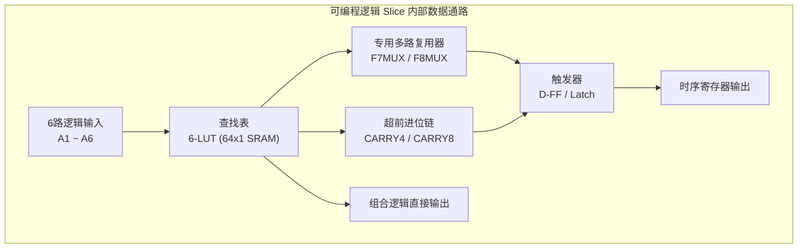
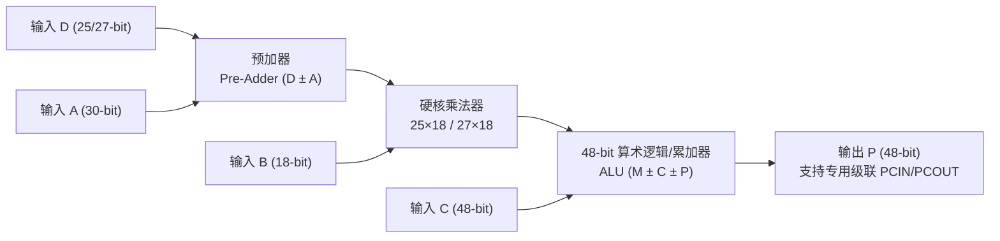

# 第一章 FPGA 基本结构与底层逻辑

**FPGA（Field-Programmable Gate Array，现场可编程门阵列）** 是一种基于查找表（LUT）架构的可编程半导体器件。与 **ASIC（专用集成电路）** 相比，FPGA 的核心优势在于其高度的**可重构性**与**硬件级并行处理能力**。

理解 FPGA 底层物理资源的组成，是写出高效 Verilog 代码和进行时序优化的基础。

---

## 1.1 可编程逻辑块（CLB / LAB）

**CLB（Configurable Logic Block，可编程逻辑块，Xilinx 称谓；Intel/Altera 称为 LAB）** 是 FPGA 实现逻辑功能的最基本单元。在主流架构中，一个 CLB 通常由多个 **Slice**（如 Xilinx 7 系列包含 `SliceL` 与 `SliceM`）组成，而每个 Slice 内部的核心逻辑组件包括：



### 1. 查找表（LUT, Look-Up Table）
- **核心作用**：FPGA 实现**组合逻辑**的核心组件。
- **物理本质**：当前主流 FPGA 普遍采用 **6 输入 LUT**（如 Xilinx 7 系列、UltraScale 及以上）。6-LUT 本质上是一个 **$64 \times 1\text{ bit}$ 的 SRAM 存储器**，输入的 6 个信号作为 SRAM 的 6 位地址线（$2^6 = 64$），LUT 内部预先烧录好逻辑真值表对应的输出结果。
- **双输出拆分能力**：1 个 6-LUT 还可以灵活配置为 **2 个独立的 5-LUT**（只要这两个 5 输入逻辑函数共享相同的 5 个输入信号），从而提高短位宽组合逻辑的资源利用率。
- **时序特性**：无论 6 输入以内的布尔逻辑表达式多么复杂（与、或、非、异或任意组合），只要不超过 6 个输入变量，通过 1 个 LUT 的传输延迟是**恒定不变**的（约几十皮秒至百皮秒级）。

### 2. 触发器（FF, Flip-Flop）
- **核心作用**：用于存储单比特状态信息，实现**时序逻辑**与流水线打拍。
- **配置特性**：每个 Slice 内含有多个 FF（通常 1 个 6-LUT 搭配 2 个 FF），通常可配置为边沿触发的 **D 触发器（D-FF）** 或电平敏感的 **D 锁存器（Latch）**，支持同步/异步复位（Reset）与置位（Set）信号，以及时钟使能端（`CE`）。

::: warning 硬件设计准则
在 FPGA 内部，**尽量避免使用 Latch（锁存器）**，因为锁存器对毛刺极其敏感，且静态时序分析（STA）工具难以对其做精准的时序收敛分析。此外，Xilinx 官方强烈推荐使用**高电平有效的同步复位**或**无复位设计（仅在控制通路复位）**，以充分利用 Slice 内部 FF 的控制端口。
:::

### 3. 多路复用器（MUX）
- **核心作用**：包括 `F7MUX`、`F8MUX`（以及 UltraScale 中的 `F9MUX`）等**专用硬核选择器**。
- **级联优势**：用于将同一个 Slice 或 CLB 内的多个 6-LUT 级联拼接，从而在不占用普通布线资源的情况下，极低延迟地组合出 **7 输入、8 输入甚至 9 输入**的复杂布尔函数或大位宽多路选择器（如 16 选 1 MUX）。

### 4. 进位链（Carry Chain）
- **核心作用**：如 Xilinx 的 **`CARRY4` / `CARRY8`** 专用硬核超前进位逻辑。
- **物理与性能优势**：进位链在芯片物理版图上**沿垂直列方向自下而上紧密排列**，走专用快速通道而不经过普通交换矩阵（Switch Matrix），极大地缩短了全加器、减法器、比较器和大位宽计数器中进位信号的传输延迟，显著提升算术运算所能跑到的最高主频。

---

## 1.2 存储单元：Block RAM vs Distributed RAM

FPGA 内部提供了两类核心片上存储器资源（在 UltraScale+ 等高端芯片中还额外提供更大容量的 **UltraRAM, URAM**）。在开发中必须根据容量、位宽与读写时序需求合理选型：

| 特性维度 | Block RAM (BRAM, 块 RAM) | Distributed RAM (DRAM, 分布式 RAM) |
| :--- | :--- | :--- |
| **物理来源** | 芯片内部独立呈列分布的**专用硬核 RAM 块**（如 Xilinx 单个块为 18Kb 或 36Kb） | 由 CLB 内部的 **`SliceM` 查找表（LUT）** 资源动态配置而成 |
| **容量大小** | **大容量**（几百 KB 到几十 MB 级） | **小容量**（几十 bit 到几 KB 级，过大会严重挤占逻辑 LUT） |
| **速度与时序** | 独立硬核，时序极佳；**不支持纯异步读**，读数据必须经过至少 1 拍时钟输出（勾选 Output Register 打 2 拍频率更高） | **支持纯组合逻辑读（异步读，地址给入即出数据）**，写操作为同步写 |
| **端口配置** | 原生支持单端口（SP）、简单双端口（SDP）、**真双端口（TDP，两端独立读写与不同位宽）** | 支持单端口、双端口、四端口等灵活小位宽读取 |
| **典型应用场景** | 大规模数据 FIFO、图像帧缓存、大容量系数 ROM 查表、CPU 指令/数据 Cache | 小深度异步/同步 FIFO（深度 $< 64$）、移位寄存器（SRL16/SRL32）、寄存器堆（RegFile） |

### 💡 Verilog 综合导向示例（控制综合器推断 BRAM 还是 DRAM）

在编写 RTL 时，读操作是否打拍决定了综合器能否将其映射为 BRAM：

```verilog
// 示例 1：异步读 -> 综合器只能推断为 Distributed RAM (消耗 LUT)
assign rdata_async = mem[raddr];

// 示例 2：同步读 -> 综合器可推断为 Block RAM (映射到独立硬核)
// 也可通过 (* ram_style = "block" *) 或 (* ram_style = "distributed" *) 属性强制指定
(* ram_style = "block" *) reg [31:0] mem [0:1023];
always @(posedge clk) begin
    if (we)
        mem[waddr] <= wdata;
    rdata_sync <= mem[raddr]; // 同步打拍读出
end
```

---

## 1.3 数字信号处理单元（DSP Slice）

在数字滤波（FIR/FFT）、矩阵乘加（AI 推理）、图像处理与通信基带算法中，如果用普通 LUT 搭建大位宽乘法器，不仅会消耗海量逻辑资源，还会导致极其恶劣的组合路径延迟。为此，FPGA 内部集成了大量专用的硬核 **DSP Slice**（例如 Xilinx 7 系列的 **`DSP48E1`**、UltraScale 的 **`DSP48E2`**）。



DSP Slice 内部的核心架构包括：
1. **预加器（Pre-Adder）**：支持 25 位（或 27 位）的先加/减运算 $(D \pm A)$。在实现**对称系数 FIR 滤波器**时，可先将对称抽头相加再送入乘法器，直接将乘法器消耗数量减半！
2. **高性能硬核乘法器（Multiplier）**：支持 **$25 \times 18$ 位**（DSP48E1）或 **$27 \times 18$ 位**（DSP48E2）的有符号数补码高速乘法。
3. **48 位算术逻辑与累加器（ALU / Accumulator）**：在乘法器后级集成 48 位加减法器与逻辑运算单元，单周期完成乘累加 **$P = P + A \times B + C$（MAC 运算）**。
4. **多级内部流水线寄存器（A/B/C/D/M/P Registers）**：DSP 硬核内部自带最多 3~4 级可配置流水线寄存器，开启全部内部流水线后，DSP48 可轻松运行在 **500 MHz ~ 700 MHz+** 的极高频率下。
5. **专用级联通道（`ACOUT` / `BCOUT` / `PCOUT`）**：相邻 DSP 之间像进位链一样沿垂直列专用总线直连，无需经过普通 CLB 布线即可实现超大位宽乘法（如 $64 \times 64$）或长阶数 FIR 滤波链。

---

## 1.4 输入输出单元（IOB）

**IOB（Input/Output Block）** 位于芯片四周边缘或特定列（Bank），负责 FPGA 内部核心逻辑电压域与外部复杂外设芯片之间的电气接口匹配和高速信号转换：

1. **多电气标准兼容（SelectIO）**：
   - **单端电平标准**：支持 `LVCMOS18`、`LVCMOS33`、`LVTTL`、`SSTL`（DDR 内存接口）等，每个 IO Bank 由独立的 `VCCO` 供电引脚决定该 Bank 的电平电压。
   - **差分信号标准**：硬件原生支持 **`LVDS`**（低压差分信号）、`TMDS`（HDMI 接口）等高速抗共模干扰传输，内置 `IBUFDS`（差分转单端输入缓冲）和 `OBUFDS`（单端转差分输出缓冲）。
   - **可编程阻抗与斜率**：支持片上端接电阻（ODT / DCI）、可调驱动电流大小与输出摆率（Slew Rate），抑制高速信号反射与振铃。
2. **专用双倍数据率寄存器（IDDR / ODDR）**：
   - 每个 IOB 内部紧挨着引脚焊盘（Pad）都集成了专用的输入/输出双沿采样寄存器。
   - **`IDDR`**：在时钟上升沿和下降沿同时采样外部双沿数据（如 RGMII 千兆以太网、ADC 高速接口），并转换为内部单沿并行的两路数据。
   - **`ODDR`**：将内部两路单沿数据在时钟双沿发出，或用于**向外部芯片高质量输出随路时钟**（避免内部时钟直接走普通逻辑布线出引脚导致偏斜失真）。
3. **串并转换硬核（ISERDES / OSERDES）与精细延迟（IODELAY）**：
   - **`ISERDES` / `OSERDES`**：在高速接口（如传感器 LVDS、DDR 控制器 PHY）中直接完成高达 1:8 或 1:10 的高速串并/并串转换。
   - **`IDELAY` / `ODELAY`**：提供以几十皮秒（ps）为步进抽头（Tap）的精细相位延迟调节，专门用于解决高速并行总线各数据线之间的板级走线等长偏差（Bit Deskew）。

---

## 1.5 时钟网络与布线资源

时钟是同步数字电路的脉搏。为了保证百万级触发器在同一时刻精准同步翻转，FPGA 内部建立了专用的树状/网格状时钟架构与层次化互联布线资源：

### 1. 全局与区域时钟网络
- **`BUFG`（Global Clock Buffer，全局时钟缓冲器）**：
  连接到全芯片对称分布的**全局时钟树（Global Clock Tree，H-Tree 结构）**。它可将时钟信号驱动至全芯片任意位置的触发器 `CLK` 端，确保到达全片各处的时钟延迟几乎相等，实现极其微小的 **Clock Skew（时钟偏斜）** 与极强的扇出驱动能力。
- **`BUFGCE` / `BUFGMUX`**：
  带无毛刺门控使能的全局时钟缓冲器（用于安全的门控时钟动态降功耗）与无毛刺时钟切换选择器（用于主备时钟热切换）。
- **`BUFR` / `BUFIO`（区域与 IO 时钟缓冲器）**：
  仅驱动单个时钟区域（Clock Region）或单个 IO Bank，延迟比全局时钟更小，常用于高速源同步接口（如采集外部 ADC 随路时钟）。

### 2. 时钟管理硬核：DCM / PLL / MMCM
现代 FPGA 内部集成了 **MMCM（Mixed-Mode Clock Manager，混合模式时钟管理器）** 与 **PLL（Phase-Locked Loop，锁相环）**，其核心职能包括：
- **频率综合（倍频与分频）**：通过可编程分频系数 $D$、反馈倍频系数 $M$（MMCM 支持小数分频）与输出分频系数 $O$，由单一晶振输入生成多路不同频率的系统时钟：
  $$f_{out} = f_{in} \times \frac{M}{D \times O}$$
- **相位偏移（Phase Shift）**：支持固定角度（如 $90^\circ, 180^\circ$）或动态微调时钟相位，常用于对齐外部 SDRAM/DDR 或高速接口采样窗口中心。
- **去抖动（Jitter Filter）与零延迟缓冲（Zero-Delay Buffer）**：滤除外部输入时钟的高频相位噪声，并通过反馈环路彻底补偿并抵消内部时钟树（BUFG）的传输延迟。

### 3. 可编程互联布线资源（Routing Resources）
- 在 FPGA 中，**布线延迟往往占总路径延迟的 60% ~ 70% 以上**（远大于 LUT 本身的逻辑门延迟）。
- 布线资源由围绕在每个 CLB 周围的**开关矩阵（Switch Matrix）**以及不同跨度的金属线段组成（单倍线 Single、双倍线 Double、四倍线 Quad、长线 Long Lines）。
- **时序优化启示**：当逻辑资源占用率过高（如超过 80%）或信号扇出（Fanout）过大时，布局布线器会出现严重的**布线拥塞（Congestion）**，被迫绕远路从而引发建立时间违例（Setup Violation）。
