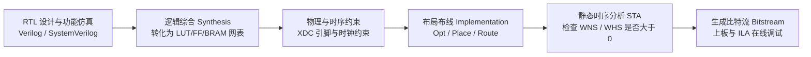

# 第二章 FPGA 开发全流程与 XDC 时序约束

理解从 Verilog RTL 源码到最终烧录进芯片的比特流（Bitstream）之间经历的每一步物理转换，以及如何用 XDC 约束指导工具完成时序收敛。

---

## 2.1 标准 FPGA 工程开发链路



1. **逻辑综合（Synthesis）**：
   将行为级/RTL 级 Verilog 代码翻译并优化为由 FPGA 底层原语（`LUT6`, `FDRE`, `CARRY4`, `RAMB36E1`, `DSP48E1` 等）组成的门级网表（Netlist）。
2. **实现（Implementation）**：
   - **`opt_design`（逻辑优化）**：裁剪无用逻辑、合并等效寄存器、优化 BRAM/DSP 功耗。
   - **`place_design`（布局）**：将网表中的逻辑原语放置到芯片物理版图上具体的 Slice、BRAM 列和 DSP 列坐标位置。
   - **`phys_opt_design`（物理级时序优化）**：针对高扇出网络自动进行寄存器复制（Register Duplication）、重定时（Retiming）。
   - **`route_design`（布线）**：配置可编程交换矩阵与金属线段，连通所有单元引脚。

---

## 2.2 核心 XDC 时序约束语法速查

### 1. 主时钟约束（Primary Clock）
所有由外部晶振输入引脚或高速收发器（GT）恢复出的源头时钟，必须使用 `create_clock` 定义：

```tcl
# 定义周期为 10.0ns (100MHz)、占空比 50% 的主时钟
create_clock -period 10.000 -name sys_clk [get_ports sys_clk_i]
```

### 2. 生成时钟约束（Generated Clock）
- **MMCM / PLL 输出的时钟**：Vivado 会根据主时钟约束**自动推导**生成时钟，无需手动重复编写。
- **用户逻辑分频时钟**（不推荐，但若存在需手动约束）：

```tcl
# 针对寄存器翻转实现的 2 分频时钟定义生成时钟
create_generated_clock -name clk_div2 \
    -source [get_pins clk_div_reg/C] \
    -divide_by 2 [get_pins clk_div_reg/Q]
```

### 3. 跨时钟域（CDC）伪路径与异步时钟组约束
对于已经做好异步 FIFO、格雷码或双触发器同步的跨时钟域路径，必须告知 STA 工具不再分析其同步时序关系：

```tcl
# 方式 1：将两个无相位关系的时钟设为异步时钟组（双向截断）
set_clock_groups -asynchronous -group [get_clocks clk_100m] -group [get_clocks clk_125m]

# 方式 2：对特定异步复位或单比特同步器输入端设置伪路径（False Path）
set_false_path -from [get_ports rst_n_i]
```

---

::: tip 待补充
欢迎在此补充 `set_input_delay`、`set_output_delay` 以及多周期路径 `set_multicycle_path` 的工程案例！
:::
