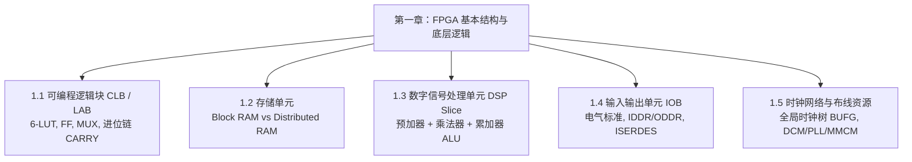

# FPGA 核心复习讲义与基础知识

> **理解底层硬件资源，是写出高质量、高主频 Verilog RTL 代码的根本前提。**

FPGA（Field-Programmable Gate Array，现场可编程门阵列）是一种基于查找表（LUT）架构的可编程半导体器件。与 ASIC（专用集成电路）相比，FPGA 的核心优势在于其高度的可重构性与并行处理能力。本板块系统梳理 FPGA 内部底层物理资源结构与核心硬核逻辑。

---

## 🗺️ 知识体系架构

---

## 📑 章节目录

- **[第一章 FPGA 基本结构与底层逻辑](./01-basic-architecture.md)**：深入剖析可编程逻辑块 CLB（LUT/FF/MUX/进位链）、BRAM 与 DRAM 对比、DSP Slice 硬核、IOB 接口逻辑以及全局时钟网络（BUFG/DCM/PLL/MMCM）。

---

::: tip 复习建议
在阅读每一节底层硬件结构时，建议结合 Vivado 的 **`Schematic`（综合后原理图）** 与 **`Device`（芯片物理版图视图）** 对照观察，直观体会每一行 Verilog 代码在硅片上究竟变成了什么电路。后续您可以在网页端随时新建补充新的讲义章节。
:::
