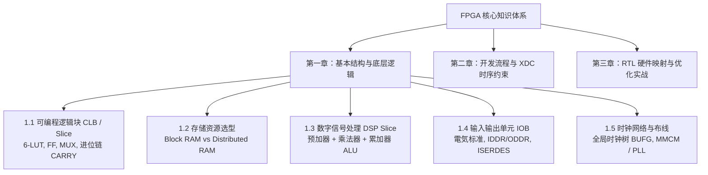

# FPGA 核心复习讲义与基础知识

> **理解底层硬件资源，是写出高质量、高主频 Verilog RTL 代码的根本前提。**

FPGA（Field-Programmable Gate Array，现场可编程门阵列）作为数字系统原型验证、边缘计算加速与高速接口通信的核心载体，其架构设计与 ASIC 有着显著差异。本板块以《FPGA 核心复习讲义》为基础，系统梳理 FPGA 内部底层结构、核心硬核资源、开发流程与工程优化方法。

---

## 🗺️ 知识体系架构

---

## 📑 章节目录

- **[第一章 FPGA 基本结构与底层逻辑](./01-basic-architecture.md)**：深入剖析 CLB（LUT/FF/MUX/进位链）、BRAM 与 DRAM 对比、DSP48 硬核、IOB 接口逻辑以及全局时钟网络（BUFG/MMCM/PLL）。
- **[第二章 FPGA 开发流程与 XDC 时序约束](./02-dev-flow-and-xdc.md)**：从 RTL 综合（Synthesis）、布局布线（Place & Route）到比特流生成的完整链路，以及核心 XDC 时序约束语法。
- **[第三章 面向 FPGA 底层结构的 RTL 编码优化](./03-coding-and-optimization.md)**：如何利用综合属性（`ram_style`、`use_dsp`）精准控制硬件资源映射、高扇出优化与复位设计准则。

---

::: tip 复习建议
在阅读每一节底层硬件结构时，建议结合 Vivado 的 **`Schematic`（综合后原理图）** 与 **`Device`（芯片物理版图视图）** 对照观察，直观体会每一行 Verilog 代码在硅片上究竟变成了什么电路。
:::
