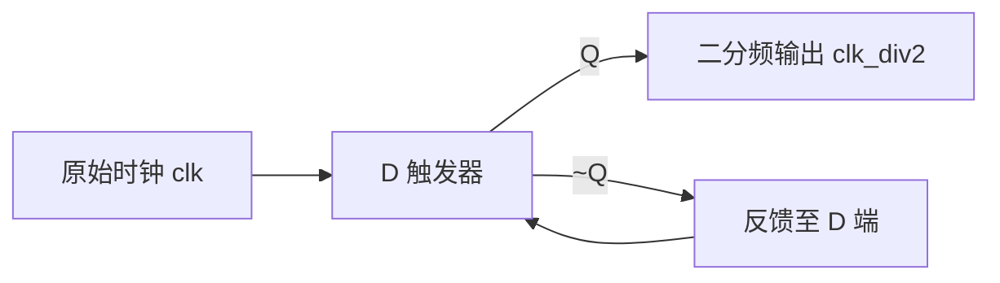

# 05. 二分频与三分频电路设计

分频器（Clock Divider）是数字集成电路与 FPGA 设计中非常基础且高频考察的电路模块。分频电路通常分为**偶数分频**和**奇数分频**两大类。在芯片面试与实际工程中，考查重点往往在于**如何实现严格 50% 占空比的时钟输出**以及**避免组合逻辑毛刺**。

---

## 1. 二分频电路设计 (Divide-by-2)

二分频是最简单也是最常见的偶数分频。输出时钟周期为输入时钟周期的 2 倍，频率减半。

### 1.1 电路原理与实现方式

1. **反相器反馈法**：将 D 触发器的反向输出端 $\bar{Q}$ 接回数据输入端 $D$。每个时钟上升沿到来时，触发器状态翻转一次。
2. **计数器法**：使用 1 位计数器在 `0` 和 `1` 之间循环递增，计数值即为二分频时钟。



### 1.2 Verilog RTL 代码实现

```verilog
// 二分频电路（50% 占空比）
module clk_div2 (
    input  wire clk,        // 原始输入时钟
    input  wire rst_n,      // 异步低电平复位
    output reg  clk_out     // 二分频输出时钟
);

    // 每个时钟上升沿翻转一次输出电平
    always @(posedge clk or negedge rst_n) begin
        if (!rst_n) begin
            clk_out <= 1'b0;
        end else begin
            clk_out <= ~clk_out; // 翻转输出
        end
    end

endmodule
```

::: tip 扩展：任意 $2N$ 偶数分频
对于任意偶数分频（如 4 分频、6 分频、8 分频），设计模为 $N$ 的计数器（从 $0$ 计数到 $N-1$），当计数器达到 $N-1$ 时使输出时钟翻转，同时计数器清零，即可得到任意 $50\%$ 占空比的偶数分频时钟。
:::

---

## 2. 三分频电路设计 (Divide-by-3)

奇数分频的难点在于：**输入时钟周期为奇数（3 个周期），若仅在上升沿采样计数，高低电平比例只能是 $1:2$ 或 $2:1$，无法直接获得严格的 50% 占空比。**

要得到严格的 50% 占空比，核心思想是：**分别利用时钟的“上升沿”与“下降沿”产生占空比非 50% 的中间时钟，再通过逻辑组合消除半个时钟周期的相位差。**

### 2.1 原理分析：双边沿与相位差补偿

- **步骤 1**：在输入时钟 `clk` 的**上升沿**设计模 3 计数器（计数范围：`0, 1, 2`）。
  - 当计数为 `0` 时输出高电平，计数为 `1, 2` 时输出低电平（高电平占 1 拍，低电平占 2 拍，占空比为 $1/3$），得到时钟信号 `clk_pos`。
- **步骤 2**：在输入时钟 `clk` 的**下降沿**采用完全相同的逻辑，产生滞后半个周期的时钟信号 `clk_neg`（同样是高电平占 1 拍，低电平占 2 拍）。
- **步骤 3**：将 `clk_pos` 与 `clk_neg` 进行**逻辑或运算（OR）**：
  $$\text{clk\_div3} = \text{clk\_pos} \ |\  \text{clk\_neg}$$
  由于两路信号高电平宽度均为 1 个时钟周期，且相互错开半个周期，相“或”之后高电平时间被拓宽为 $1 + 0.5 = 1.5$ 个时钟周期。在总周期为 3 的情况下，高电平占 1.5，低电平占 1.5，从而获得**严格 50% 占空比**！

### 2.2 时序波形推导

```text
clk       :   __--__--__--__--__--__--__--__--__--
cnt_pos   :  |  0  |  1  |  2  |  0  |  1  |  2  |
clk_pos   :  ---_______-------_______-------______ (高1拍，低2拍)
cnt_neg   :    |  0  |  1  |  2  |  0  |  1  |  2
clk_neg   :  ----_______-------_______-------_____ (滞后半拍)
clk_div3  :  ----______-------______-------______ (相或: 高1.5拍，低1.5拍 -> 50%占空比)
```

### 2.3 完整可综合 Verilog RTL 代码

```verilog
// 三分频电路（严格 50% 占空比）
module clk_div3 (
    input  wire clk,        // 原始输入时钟
    input  wire rst_n,      // 异步低电平复位
    output wire clk_out     // 三分频输出时钟（50% 占空比）
);

    // 上升沿模3计数器与输出信号
    reg [1:0] cnt_p;
    reg       clk_p;

    // 下降沿模3计数器与输出信号
    reg [1:0] cnt_n;
    reg       clk_n;

    // 1. 上升沿计数逻辑 (0 -> 1 -> 2 -> 0)
    always @(posedge clk or negedge rst_n) begin
        if (!rst_n) begin
            cnt_p <= 2'b00;
        end else if (cnt_p == 2'd2) begin
            cnt_p <= 2'b00;
        end else begin
            cnt_p <= cnt_p + 1'b1;
        end
    end

    // 上升沿产生占空比 1/3 的脉冲 (在计数为0时输出高电平，持续1拍)
    always @(posedge clk or negedge rst_n) begin
        if (!rst_n) begin
            clk_p <= 1'b0;
        end else if (cnt_p == 2'd0) begin
            clk_p <= 1'b1;
        end else begin
            clk_p <= 1'b0;
        end
    end

    // 2. 下降沿计数逻辑 (滞后半周期)
    always @(negedge clk or negedge rst_n) begin
        if (!rst_n) begin
            cnt_n <= 2'b00;
        end else if (cnt_n == 2'd2) begin
            cnt_n <= 2'b00;
        end else begin
            cnt_n <= cnt_n + 1'b1;
        end
    end

    // 下降沿产生占空比 1/3 的脉冲
    always @(negedge clk or negedge rst_n) begin
        if (!rst_n) begin
            clk_n <= 1'b0;
        end else if (cnt_n == 2'd0) begin
            clk_n <= 1'b1;
        end else begin
            clk_n <= 1'b0;
        end
    end

    // 3. 逻辑或运算合并输出，生成严格 50% 占空比三分频时钟
    assign clk_out = clk_p | clk_n;

endmodule
```

::: warning 工程设计提示（毛刺与时钟树）
在现代 ASIC/FPGA 设计中，由组合逻辑（如上面的 `|` 或门）直接生成的时钟称为**纹波时钟（Ripple Clock）**或**门控/行波时钟**。这种时钟无法直接利用芯片专用的全局时钟树驱动网络（BUFG），且容易引入毛刺。因此在实际工程中：
1. **推荐使用“时钟使能（Clock Enable）”结构**替代直接门控分频；
2. 若确实需要低频时钟驱动大扇出，建议在 FPGA 中例化 **MMCM / PLL** 锁相环硬核，以获得最低的时钟抖动与偏斜。
:::
