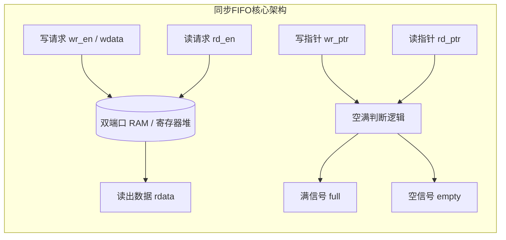
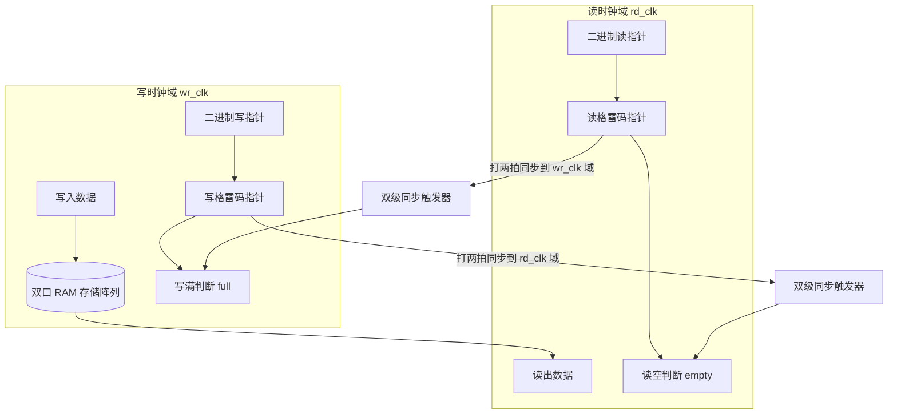

# 06. FIFO 架构设计与实现（同步与异步）

FIFO（First In, First Out，先进先出队列）是数字集成电路、SoC 总线接口与通信协议中最核心的基础数据缓冲组件。它的主要应用场景包括：
1. **多级流水线速率匹配**：上下游处理速度不匹配时作为弹性缓冲；
2. **总线位宽转换**：将低位宽接口数据拼接转为高位宽；
3. **跨时钟域（CDC）数据隔离**：在不同时钟频率/相位的模块间安全传递多比特数据流。

---

## 1. 同步 FIFO 设计 (Synchronous FIFO)

同步 FIFO 指**读时钟（`rd_clk`）与写时钟（`wr_clk`）为同一个时钟源**。电路内部无需处理跨时钟域亚稳态，核心在于**读写指针的维护与“空/满”状态的精确判断**。



### 1.1 空满判断方法

常见有两种判断方式：
- **方式 A（计数器法）**：维护一个内部计数器 `fifo_cnt`。写操作加 1，读操作减 1，读写同时不加不减。`fifo_cnt == 0` 时为空，`fifo_cnt == DEPTH` 时为满。该方法逻辑直观，但计数器在大深度时会消耗较长进位链。
- **方式 B（指针扩展 1 位法）**：若 FIFO 深度为 $2^N$，读写地址位宽为 $N$ 位，我们将读写指针位宽扩展为 $N+1$ 位。
  - **空标志（`empty`）**：读写指针的全部 $N+1$ 位**完全相等**（说明读指针赶上了写指针）；
  - **满标志（`full`）**：读写指针的**最高位和次高位不同，其余低 $N$ 位完全相同**（说明写指针比读指针刚好整整多跑了一圈）。

### 1.2 完整同步 FIFO Verilog RTL 代码

```verilog
// 同步 FIFO 设计（指针扩展1位法）
module sync_fifo #(
    parameter DATA_WIDTH = 8,       // 数据位宽
    parameter DATA_DEPTH = 16,      // FIFO 深度（必须为 2 的幂次方）
    parameter ADDR_WIDTH = 4        // 地址位宽（DATA_DEPTH = 2^ADDR_WIDTH）
)(
    input  wire                   clk,        // 系统时钟
    input  wire                   rst_n,      // 异步复位（低有效）
    
    // 写接口
    input  wire                   wr_en,      // 写使能
    input  wire [DATA_WIDTH-1:0]  wdata,      // 写入数据
    output wire                   full,       // 满标志
    
    // 读接口
    input  wire                   rd_en,      // 读使能
    output wire [DATA_WIDTH-1:0]  rdata,      // 读出数据
    output wire                   empty       // 空标志
);

    // 内部双端口存储阵列
    reg [DATA_WIDTH-1:0] mem [0:DATA_DEPTH-1];

    // 扩展 1 位的读写指针（最高位为圈数标志，低位为实际 RAM 地址）
    reg [ADDR_WIDTH:0] wr_ptr;
    reg [ADDR_WIDTH:0] rd_ptr;

    // 写操作：非满且写使能有效时写入
    wire wr_valid = wr_en && (!full);
    always @(posedge clk or negedge rst_n) begin
        if (!rst_n) begin
            wr_ptr <= {(ADDR_WIDTH+1){1'b0}};
        end else if (wr_valid) begin
            mem[wr_ptr[ADDR_WIDTH-1:0]] <= wdata;
            wr_ptr <= wr_ptr + 1'b1;
        end
    end

    // 读操作：非空且读使能有效时递增指针
    wire rd_valid = rd_en && (!empty);
    always @(posedge clk or negedge rst_n) begin
        if (!rst_n) begin
            rd_ptr <= {(ADDR_WIDTH+1){1'b0}};
        end else if (rd_valid) begin
            rd_ptr <= rd_ptr + 1'b1;
        end
    end

    // 读出数据（此处为 RAM 异步首读/先看模式，也可改为同步打拍读出）
    assign rdata = mem[rd_ptr[ADDR_WIDTH-1:0]];

    // 空满判断逻辑
    // 空：最高位和低位地址完全相同
    assign empty = (wr_ptr == rd_ptr);
    // 满：最高位相反，低位地址完全相同
    assign full  = (wr_ptr[ADDR_WIDTH] != rd_ptr[ADDR_WIDTH]) &&
                   (wr_ptr[ADDR_WIDTH-1:0] == rd_ptr[ADDR_WIDTH-1:0]);

endmodule
```

---

## 2. 异步 FIFO 设计 (Asynchronous FIFO)

异步 FIFO 的**写时钟（`wr_clk`）与读时钟（`rd_clk`）频率不同、相位无关**。它是解决多比特数据流跨时钟域传输的最经典、最通用方案。



### 2.1 核心挑战与关键技术

#### 1. 为什么不能直接同步二进制指针？
如果直接用打两拍同步多比特二进制指针，当指针从 `0111` 变为 `1000` 时，4 个比特位同时翻转。由于芯片物理布线延迟存在微小差异，接收端采样时可能采到 `0110`、`1111` 等任意中间未知态，导致空满状态严重误判。

#### 2. 格雷码（Gray Code）的作用
- **特性**：相邻两个数值之间**只有 1 位发生改变**。
- **优势**：跨时钟域采样时，即使发生亚稳态，采样结果也只会是“翻转前的值”或“翻转后的值”，**绝不会出现第三方随机值**。
- **二进制转格雷码公式**：
  $$\text{gray} = \text{bin} \ \oplus \ (\text{bin} \gg 1)$$

#### 3. 异步 FIFO 格雷码空满判断准则
设读写指针位宽扩展为 $N+1$ 位：
- **读空（`empty`）在读时钟域判断**：
  当前读指针格雷码，与同步过来的写指针格雷码**完全相等**：
  $$\text{empty} = (\text{rd\_gray\_ptr} == \text{wr\_gray\_ptr\_sync})$$
- **写满（`full`）在写时钟域判断**：
  当前写指针格雷码，与同步过来的读指针格雷码：**最高位相反、次高位相反、其余低位完全相同**：
  $$\text{full} = (\text{wr\_gray}[N] \ne \text{rd\_gray\_sync}[N]) \ \land \ (\text{wr\_gray}[N-1] \ne \text{rd\_gray\_sync}[N-1]) \ \land \ (\text{wr\_gray}[N-2:0] == \text{rd\_gray\_sync}[N-2:0])$$

::: info 为什么满判断要求“前两位相反”？
在格雷码编码体系中，前两位的翻转代表二进制指针相差了半个大周期（即 $2^N$ 深度），正好表示写指针比读指针领先了一整圈。
:::

### 2.2 “假满”与“假空”现象（保守安全设计）

- **假空**：读时钟域采样到的写指针需要经过 2 拍同步延迟。在这 2 拍内，写时钟域可能又写入了新数据，导致实际不空但判断为空。
- **假满**：写时钟域采样到的读指针同样有 2 拍同步延迟。在这 2 拍内，读时钟域可能又读出了数据，导致实际不满但判断为满。
- **结论**：“假满/假空”只会导致 FIFO 传输吞吐短暂保守地停顿，**绝不会发生下溢（Underflow / 读空数据）或上溢（Overflow / 覆盖未读数据）**，在功能与安全性上是完全正确的。

### 2.3 完整异步 FIFO Verilog RTL 代码

```verilog
// 异步 FIFO 经典可综合实现
module async_fifo #(
    parameter DATA_WIDTH = 8,       // 数据位宽
    parameter DATA_DEPTH = 16,      // FIFO 深度（必须为 2 的幂次方）
    parameter ADDR_WIDTH = 4        // 地址位宽（DATA_DEPTH = 2^ADDR_WIDTH）
)(
    // 写时钟域信号
    input  wire                   wr_clk,
    input  wire                   wr_rst_n,
    input  wire                   wr_en,
    input  wire [DATA_WIDTH-1:0]  wdata,
    output wire                   full,

    // 读时钟域信号
    input  wire                   rd_clk,
    input  wire                   rd_rst_n,
    input  wire                   rd_en,
    output wire [DATA_WIDTH-1:0]  rdata,
    output wire                   empty
);

    // 双口 RAM 存储介质
    reg [DATA_WIDTH-1:0] mem [0:DATA_DEPTH-1];

    // 写时钟域二进制与格雷码指针
    reg  [ADDR_WIDTH:0] wr_bin_ptr;
    wire [ADDR_WIDTH:0] wr_gray_ptr;
    wire [ADDR_WIDTH:0] wr_bin_next;
    wire [ADDR_WIDTH:0] wr_gray_next;

    // 读时钟域二进制与格雷码指针
    reg  [ADDR_WIDTH:0] rd_bin_ptr;
    wire [ADDR_WIDTH:0] rd_gray_ptr;
    wire [ADDR_WIDTH:0] rd_bin_next;
    wire [ADDR_WIDTH:0] rd_gray_next;

    // 同步寄存器打两拍定义（添加 ASYNC_REG 属性防综合重定时与优化）
    (* ASYNC_REG = "TRUE" *) reg [ADDR_WIDTH:0] wr_gray_sync_d1, wr_gray_sync_d2;
    (* ASYNC_REG = "TRUE" *) reg [ADDR_WIDTH:0] rd_gray_sync_d1, rd_gray_sync_d2;

    // -------------------------------------------------------------
    // 1. 写逻辑（写时钟域）
    // -------------------------------------------------------------
    wire wr_valid = wr_en && (!full);
    
    // RAM 写入
    always @(posedge wr_clk) begin
        if (wr_valid) begin
            mem[wr_bin_ptr[ADDR_WIDTH-1:0]] <= wdata;
        end
    end

    // 写指针递增与转换
    assign wr_bin_next  = wr_bin_ptr + (wr_valid ? 1'b1 : 1'b0);
    assign wr_gray_next = wr_bin_next ^ (wr_bin_next >> 1); // 二进制转格雷码

    always @(posedge wr_clk or negedge wr_rst_n) begin
        if (!wr_rst_n) begin
            wr_bin_ptr <= {(ADDR_WIDTH+1){1'b0}};
        end else begin
            wr_bin_ptr <= wr_bin_next;
        end
    end

    assign wr_gray_ptr = wr_bin_ptr ^ (wr_bin_ptr >> 1);

    // -------------------------------------------------------------
    // 2. 读逻辑（读时钟域）
    // -------------------------------------------------------------
    wire rd_valid = rd_en && (!empty);

    // RAM 读出
    assign rdata = mem[rd_bin_ptr[ADDR_WIDTH-1:0]];

    // 读指针递增与转换
    assign rd_bin_next  = rd_bin_ptr + (rd_valid ? 1'b1 : 1'b0);
    assign rd_gray_next = rd_bin_next ^ (rd_bin_next >> 1);

    always @(posedge rd_clk or negedge rd_rst_n) begin
        if (!rd_rst_n) begin
            rd_bin_ptr <= {(ADDR_WIDTH+1){1'b0}};
        end else begin
            rd_bin_ptr <= rd_bin_next;
        end
    end

    assign rd_gray_ptr = rd_bin_ptr ^ (rd_bin_ptr >> 1);

    // -------------------------------------------------------------
    // 3. 跨时钟域指针同步（双触发器打两拍）
    // -------------------------------------------------------------
    // 将写格雷码指针同步到读时钟域（用于判断读空）
    always @(posedge rd_clk or negedge rd_rst_n) begin
        if (!rd_rst_n) begin
            wr_gray_sync_d1 <= {(ADDR_WIDTH+1){1'b0}};
            wr_gray_sync_d2 <= {(ADDR_WIDTH+1){1'b0}};
        end else begin
            wr_gray_sync_d1 <= wr_gray_ptr;
            wr_gray_sync_d2 <= wr_gray_sync_d1;
        end
    end

    // 将读格雷码指针同步到写时钟域（用于判断写满）
    always @(posedge wr_clk or negedge wr_rst_n) begin
        if (!wr_rst_n) begin
            rd_gray_sync_d1 <= {(ADDR_WIDTH+1){1'b0}};
            rd_gray_sync_d2 <= {(ADDR_WIDTH+1){1'b0}};
        end else begin
            rd_gray_sync_d1 <= rd_gray_ptr;
            rd_gray_sync_d2 <= rd_gray_sync_d1;
        end
    end

    // -------------------------------------------------------------
    // 4. 空/满标志判定
    // -------------------------------------------------------------
    // 读空判断：读指针与同步过来的写指针格雷码完全相等
    assign empty = (rd_gray_ptr == wr_gray_sync_d2);

    // 写满判断：高两位相反，低位完全相等
    assign full  = (wr_gray_ptr[ADDR_WIDTH]     != rd_gray_sync_d2[ADDR_WIDTH]) &&
                   (wr_gray_ptr[ADDR_WIDTH-1]   != rd_gray_sync_d2[ADDR_WIDTH-1]) &&
                   (wr_gray_ptr[ADDR_WIDTH-2:0] == rd_gray_sync_d2[ADDR_WIDTH-2:0]);

endmodule
```

---

## 3. 工程综合与约束注意事项

1. **时序约束（XDC）**：由于 `wr_clk` 与 `rd_clk` 为异步时钟，静态时序分析（STA）工具默认会对其进行分析。必须使用异步时钟组约束截断两者的跨时钟域分析：
   ```tcl
   set_clock_groups -asynchronous -group [get_clocks wr_clk] -group [get_clocks rd_clk]
   ```
2. **布局约束与 `ASYNC_REG`**：在 Verilog 代码中为两级同步触发器添加 `(* ASYNC_REG = "TRUE" *)` 属性，强制布局布线器将其放在同一 Slice 内部，以最小化布线延迟，提升平均无故障时间（MTBF）。
