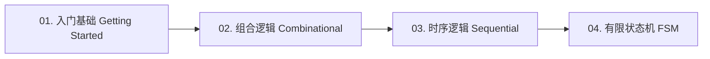

# HDLBits 刷题记录与精析

HDLBits 是数字 IC 与 FPGA 工程师最经典的 Verilog 在线刷题平台，涵盖从基础语法、组合逻辑、时序电路、有限状态机（FSM）到复杂工程模块的完整练习体系。

---

## 📚 刷题路线规划

- **[01. 语言基础与入门](./01-getting-started.md)**：Wire、Vector、模块例化、三元运算符等。
- **[02. 组合逻辑电路](./02-combinational-logic.md)**：门电路、多路选择器 MUX、算术逻辑单元 ALU、加法器。
- **[03. 时序逻辑电路](./03-sequential-logic.md)**：D 触发器同步/异步复位、★经典真题精析：黑盒电路有效建立时间（Setup）与保持时间（Hold）推导计算。
- **[04. 有限状态机 (FSM)](./04-finite-state-machines.md)**：一段式/二段式/三段式状态机建模规范与复杂序列检测。

::: tip 💡 进阶手撕电路专栏导流
关于芯片设计核心高频手撕电路（**二分频与三分频电路**、**同步/异步 FIFO 架构**、**异步复位同步释放电路**），已统筹收录并归整至 **[数字 IC 核心八股](../ic-interview/)** 专栏，包含更深入的时序分析推导与工业级可综合 RTL 实现！
:::

---

::: tip 刷题心得备忘
在写 Verilog 代码时，时刻牢记：**“你是在用代码描绘硬件电路，而不是写顺序执行的软件程序”**。
- 组合逻辑用 `always @(*)` 搭配阻塞赋值 `=`
- 时序逻辑用 `always @(posedge clk)` 搭配非阻塞赋值 `<=`
:::
