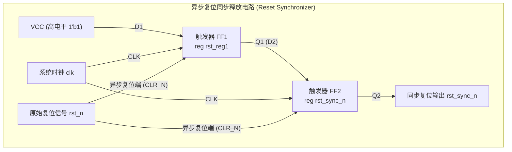
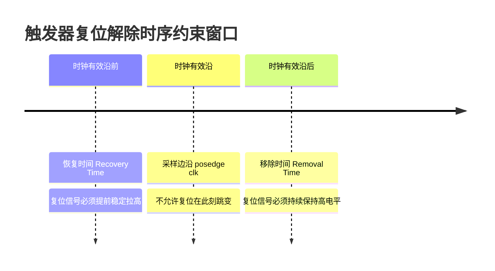

# 05. 异步复位同步解除电路设计与原理分析

在数字 IC 与 FPGA 设计中，复位网络与时钟网络同为芯片最关键的全局控制网络。**“异步复位、同步释放（解除）”**（Asynchronous Reset Synchronous Deassert / Release）是工业界最标准、也是各大芯片公司面试中出现频次最高的手撕电路之一。

---

## 1. 核心电路设计与 Verilog 实现

该电路核心思想是：**复位信号有效时，无须等待时钟沿立即生效（异步复位）；复位信号撤销时，通过两级触发器打两拍与系统时钟同步后再行释放（同步解除）**。

### 1.1 电路逻辑框图



### 1.2 Verilog RTL 实现代码

```verilog
// =============================================================================
// 模块名称: rst_sync (异步复位同步解除模块)
// 功能描述: 原始复位低电平有效输入，产生与目标时钟域 clk 同步解除的复位输出
// 设计规范: Verilog-2001 标准，两级寄存器消除亚稳态
// =============================================================================
module rst_sync(
    input  wire clk,        // 目标时钟信号
    input  wire rst_n,      // 异步复位输入（低电平有效）
    output reg  rst_sync_n  // 同步释放复位输出（低电平有效）
);

    // 第一级同步寄存器（用于捕获并隔离释放时的亚稳态）
    reg rst_reg1;

    // 敏感列表中包含时钟上升沿与复位下降沿（保证复位时异步生效）
    always @(posedge clk or negedge rst_n) begin
        if (!rst_n) begin
            // 异步复位阶段：rst_n 一旦下拉为 0，无论 clk 是否翻转，立即清零
            rst_reg1   <= 1'b0;
            rst_sync_n <= 1'b0;
        end
        else begin
            // 同步释放阶段：rst_n 恢复为 1 后，输入固定高电平 1'b1
            // 经过两个时钟上升沿打两拍传递到输出，完成同步释放
            rst_reg1   <= 1'b1;
            rst_sync_n <= rst_reg1;
        end
    end

endmodule
```

---

## 2. 深度原理分析：为什么必须“同步解除”？

### 2.1 纯异步复位的隐患：Recovery 与 Removal 时间违例

纯异步复位电路（`always @(posedge clk or negedge rst_n)`）在**复位拉低**时是绝对安全的，因为复位具有最高优先级，瞬间强制触发器回到初态。

然而，**在复位信号解除（拉高跳变）的瞬间**，如果这个跳变沿恰好发生在时钟上升沿附近，触发器就会陷入**亚稳态（Metastability）**。为了保证复位能被正确解除，静态时序分析（STA）定义了两个专属时序指标：



1. **恢复时间 ($T_{recovery}$)**：
   - **定义**：在时钟有效沿到来**之前**，异步复位信号由有效变为无效（拉高）所必须保持稳定的最小时间区间。
   - **类比**：相当于复位信号的**建立时间 ($T_{setup}$)**。若违例，触发器可能无法正确退出复位状态，输出振荡或未定义。
2. **移除时间 ($T_{removal}$)**：
   - **定义**：在时钟有效沿到来**之后**，异步复位信号由有效变为无效后必须继续保持高电平的最小时间区间。
   - **类比**：相当于复位信号的**保持时间 ($T_{hold}$)**。若违例，复位可能会被误当做生效或产生竞争冒险。

### 2.2 双级触发器如何消除亚稳态？

当原始异步复位 `rst_n` 在时钟边沿附近撤销并触发 $T_{recovery}$ 或 $T_{removal}$ 违例时：

1. **第一级触发器 `rst_reg1`**：可能会产生亚稳态（输出电压悬浮在中间电平或产生暂态振荡）。
2. **经过一个时钟周期 ($T_{clk}$)**：在绝大多数情况下，亚稳态振荡会在一个周期内衰减并稳定到确定电平（逻辑 `0` 或逻辑 `1`）。
3. **第二级触发器 `rst_sync_n`**：在下一个时钟上升沿采到的已经是稳定且确定的逻辑电平，**彻底切断了亚稳态向后级功能逻辑电路扩散的路径**。

因此：
- **复位生效时**：完全是异步直接清零，零延迟响应，确保芯片上电或异常时立即进入受控初态。
- **复位解除时**：所有后续后级逻辑的触发器将在同一个确定时钟上升沿之后整齐划一地退出复位，避免了时序逻辑因不同走线延迟导致“有的触发器先退复位、有的后退复位”的严重状态紊乱。

---

## 3. 三种复位方案横向对比

| 对比维度 | 同步复位 (Sync Reset) | 纯异步复位 (Pure Async Reset) | 异步复位、同步释放 (Recommended) |
| :--- | :--- | :--- | :--- |
| **电路灵敏度** | 必须等待时钟上升沿，短脉冲易被漏采 | 立即生效，对毛刺极其敏感 | 生效立即响应；释放受时钟同步保护 |
| **时钟依赖性** | 无时钟时无法复位（如 PLL 未锁定时） | 无需时钟即可复位芯片 | 复位无需时钟；撤除需要时钟翻转 |
| **亚稳态风险** | 无 Recovery/Removal 亚稳态 | 释放时极易发生亚稳态 | **完全消除释放时的亚稳态风险** |
| **逻辑资源与面积** | 会消耗数据端 MUX 组合逻辑资源 | 复位走专用 CLR 端口，数据路径更干净 | 仅额外消耗 2 个触发器单元，性价比极高 |
| **业界应用场景** | Xilinx FPGA 部分高速纯同步数据流 | 极简单低速外围电路 | **ASIC 标准设计流程与高可靠性 SoC 首选** |

---

## 4. 工程实践与高频面试要点

### Q1：复位信号如果有毛刺（Glitch）会怎么样？如何防御？
- **现象**：由于异步端对低电平敏感，外部复位引脚上的毛刺哪怕只有几纳秒，也会瞬间复位整个芯片。
- **对策**：在工程上，外部引脚复位信号进入芯片后，通常会先经过**施密特触发器（抗慢边沿干扰）**，或者接一级**数字去抖滤波器（Debounce Filter，例如连续检测多个时钟周期为低电平才判定为真复位）**，然后再送入 `rst_sync`。

### Q2：两级触发器够用吗？什么时候需要打三拍？
- 通常情况下，两级触发器提供的 **MTBF（平均无故障工作时间）** 已经可以达到几百乃至上万年，足以满足常规商业芯片标准。
- 在超高主频（如 GHz 级别）、超深亚微米（7nm / 5nm 以下）工艺或车规/航天级高可靠芯片中，由于建立/保持时间窗口占时钟周期的比例上升，通常会采用**打三拍（三级同步器）**来进一步指数级提升 MTBF。
