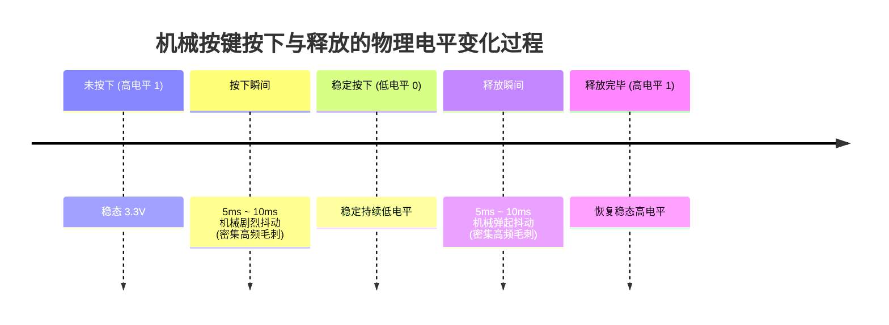
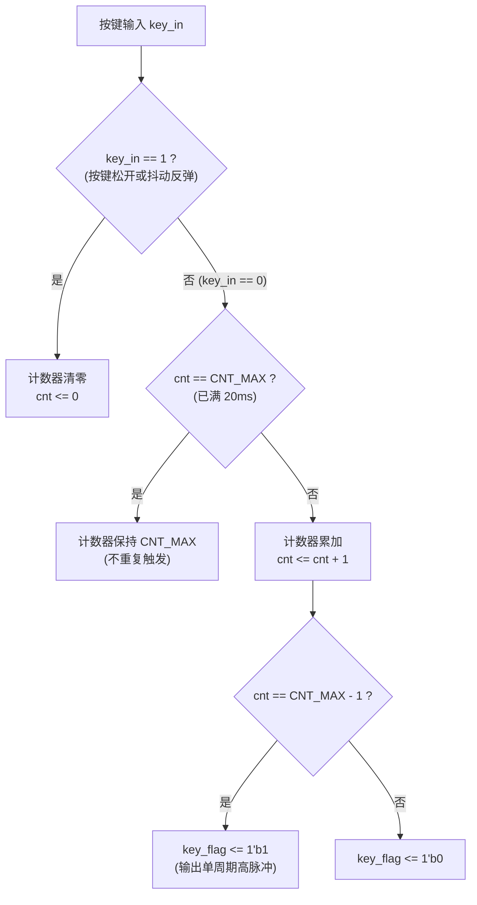

# 07. 按键消抖电路设计与原理分析

在数字集成电路（ASIC）前端与 FPGA 工程实践中，**按键消抖（Key Debounce / Filter）** 是连接外部物理机械开关与芯片内部数字同步逻辑的经典接口电路，也是硬件笔试与面试中高频考察的时序控制与计数器手撕代码题。

---

## 1. 物理机理：为什么必须消抖？

### 1.1 机械按键的接触抖动特性

常见的机械按键内部由微型金属弹簧片构成。当按下或释放按键时，由于金属触点的机械弹性与接触面不平整，触点闭合与断开瞬间并不会立即呈现理想的阶跃跳变，而是会产生一段短暂的高频开闭振荡，即**机械抖动（Mechanical Bounce）**。



- **抖动持续时间**：通常为 **$5\text{ ms} \sim 20\text{ ms}$** 不等；
- **若不消除抖动**：对于工作在几十兆赫兹（如 $50\text{ MHz}$，周期仅 $20\text{ ns}$）的数字芯片，这几毫秒的抖动相当于成千上万个伪时钟/使能脉冲，会导致内部状态机跳转紊乱或计数器误加数十次。

---

## 2. 核心电路设计与 Verilog 实现

### 2.1 滤波设计思路（连续低电平计时法）

按键默认通过上拉电阻接电源（平时为高电平 `1`，按下导通接地为低电平 `0`）：
1. **抖动过滤**：只要检测到按键为高电平（松手或前沿抖动），计时计数器立即清零；
2. **稳定计时**：当按键变为低电平时，启动累加计数；
3. **阈值锁死**：若按键持续保持低电平达到 $20\text{ ms}$（说明抖动已完全过去，按键确已按下），计数器停止递增并保持在最大值，防止循环触发；
4. **单周期有效脉冲输出**：在计数器达到阈值的前一瞬间，产生宽度为**严格 1 个时钟周期的脉冲信号（`key_flag`）**，供后级模块使用。



### 2.2 计数器位宽与阈值计算

设系统主频为 $f_{clk} = 50\text{ MHz}$，时钟周期为 $T = \frac{1}{50\text{ MHz}} = 20\text{ ns}$。
消抖目标时间 $T_{debounce} = 20\text{ ms} = 2 \times 10^{-2}\text{ s}$：

$$\text{CNT\_MAX} = \frac{T_{debounce}}{T} = \frac{20\text{ ms}}{20\text{ ns}} = 1,000,000 \ \text{个时钟周期}$$

从 $0$ 开始计数到 $999,999$（共 $1,000,000$ 拍）。
因为 $2^{19} = 524,288 < 1,000,000 < 2^{20} = 1,048,576$，因此计数器位宽需声明为 **`[19:0]`**（共 20 位）。

### 2.3 经典 Verilog RTL 代码实现

```verilog
// =============================================================================
// 模块名称: key_filter (按键消抖模块)
// 功能描述: 针对 50MHz 时钟下外部低有效按键进行 20ms 延时消抖，产生单周期有效脉冲
// 设计规范: Verilog-2001，参数化配置，可综合实现
// =============================================================================
module key_filter #(
    parameter CNT_MAX = 20'd999_999 // 50MHz 主频下 20ms 对应的计数值 (1,000,000 - 1)
)(
    input  wire clk,        // 系统时钟 50MHz
    input  wire rst_n,      // 异步复位信号（低电平有效）
    input  wire key_in,     // 外部物理按键输入（低电平有效）
    output reg  key_flag    // 消抖后产生的有效按键高脉冲（持续1个clk周期）
);

    // 20ms 定时计数器（20位位宽：最大可表示 1,048,575 > 999,999）
    reg [19:0] cnt_20ms;

    // -------------------------------------------------------------
    // 1. 20ms 计时控制逻辑
    // -------------------------------------------------------------
    always @(posedge clk or negedge rst_n) begin
        if (!rst_n) begin
            cnt_20ms <= 20'd0;
        end
        else if (key_in == 1'b1) begin
            // 按键未按下或发生弹起毛刺时，立即清零，重新开始滤除
            cnt_20ms <= 20'd0;
        end
        else if (cnt_20ms == CNT_MAX && key_in == 1'b0) begin
            // 计数已满 20ms 且按键依然保持稳定按下：锁死计数器，避免反复产生脉冲
            cnt_20ms <= cnt_20ms;
        end
        else begin
            // 按键为低电平但尚未达到 20ms：递增计数
            cnt_20ms <= cnt_20ms + 1'b1;
        end
    end

    // -------------------------------------------------------------
    // 2. 单周期有效脉冲产生逻辑
    // -------------------------------------------------------------
    always @(posedge clk or negedge rst_n) begin
        if (!rst_n) begin
            key_flag <= 1'b0;
        end
        else if (cnt_20ms == CNT_MAX - 1'b1) begin
            // 在计数即将达到 20ms 的那一拍拉高 1 个时钟周期
            key_flag <= 1'b1;
        end
        else begin
            key_flag <= 1'b0;
        end
    end

endmodule
```

---

## 3. 工业级进阶考点：双边沿消抖与防亚稳态处理

在更高可靠性的 SoC 与工业控制场景中，上述简单计数器方案有两个进阶优化考点：

### 3.1 跨时钟域防亚稳态（CDC 防御）
外部按键是绝对的**异步信号**，可能随时发生跳变。如果直接用 `if (key_in)` 采样，会破坏寄存器的建立/保持时间导致亚稳态。
- **改进对策**：在进入消抖逻辑前，先对 `key_in` 用系统时钟**双触发器打两拍**同步：
  ```verilog
  reg key_in_d1, key_in_d2;
  always @(posedge clk or negedge rst_n) begin
      if (!rst_n) begin
          key_in_d1 <= 1'b1;
          key_in_d2 <= 1'b1;
      end else begin
          key_in_d1 <= key_in;
          key_in_d2 <= key_in_d1;
      end
  end
  ```

### 3.2 双边沿消抖与按键电平状态输出
上述代码主要检测“按下时的下冲抖动”。若需要支持**按键释放时的上冲抖动消抖**，或需要输出稳定的**消抖后电平信号（`key_state`）**：
- **核心架构**：采用**边沿检测（检测按键是否发生跳变）** + **单次定时器（只要有跳变就重新计数 20ms）**。当 20ms 期间没有任何跳变后，在稳定时刻对按键电平进行锁存输出。
