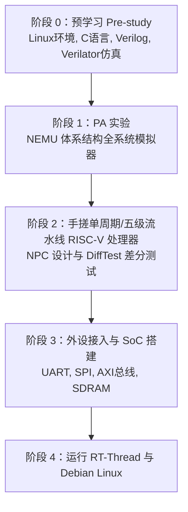

# “一生一芯” 学习全记录

中国科学院大学“一生一芯”计划（OSCPU），旨在通过贯穿计算机体系结构、模拟器开发（NEMU）、RISC-V 处理器硬件设计（NPC）、仿真验证（Verilator / NVBoard）到最终流片的全流程培养。

---

## 🗺️ 阶段路线规划

---

## 📑 章节导航

- **[01. F阶段](./01-pre-study.md)**

---

::: tip 一生一芯格言
“自己动手实现过一遍的东西，才真正属于你自己。”
:::
